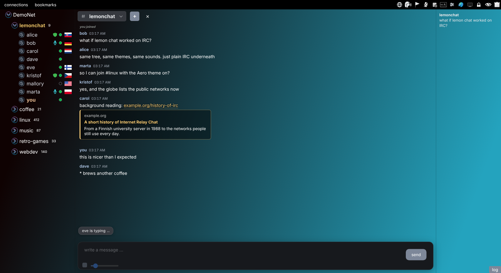
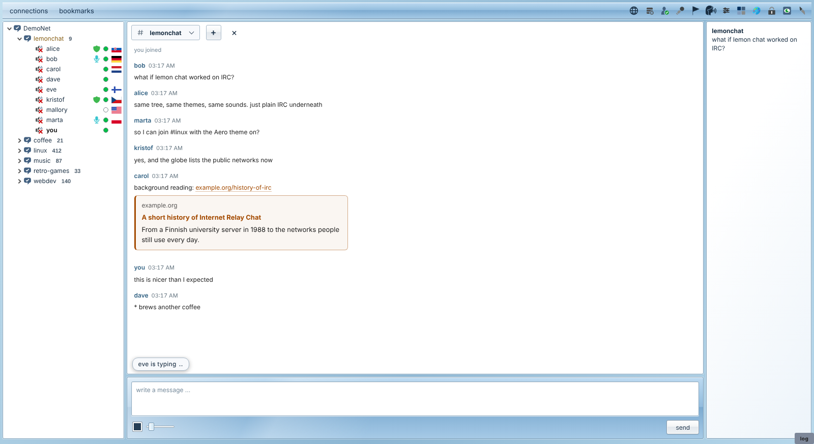
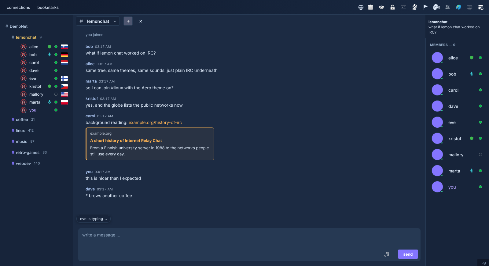
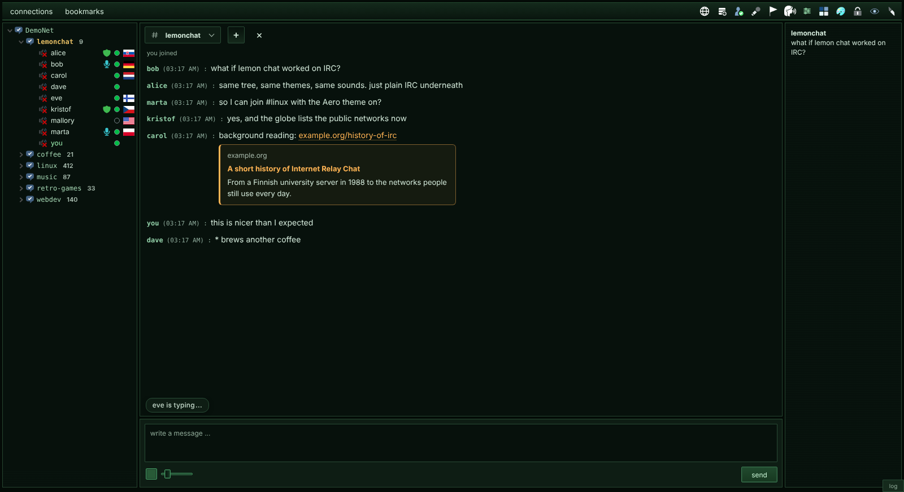
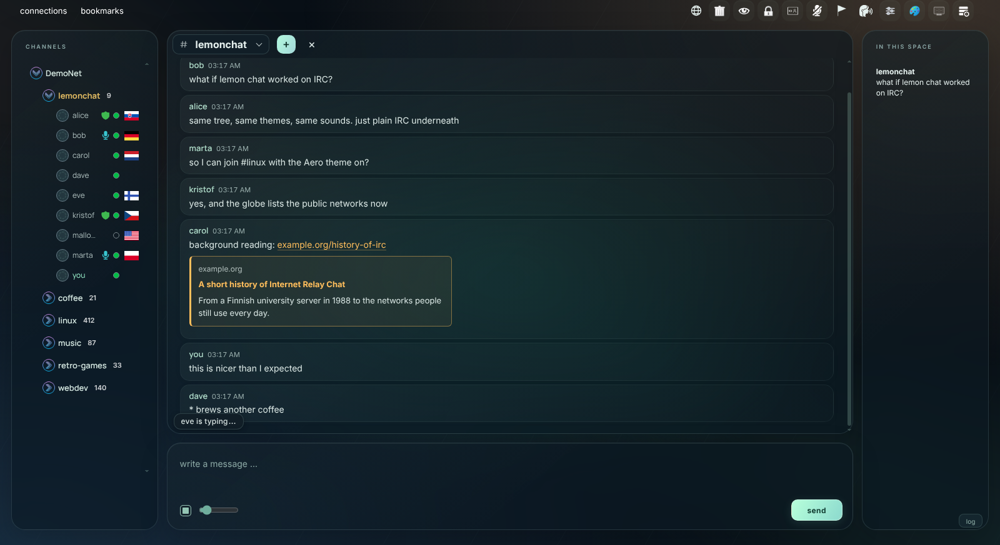
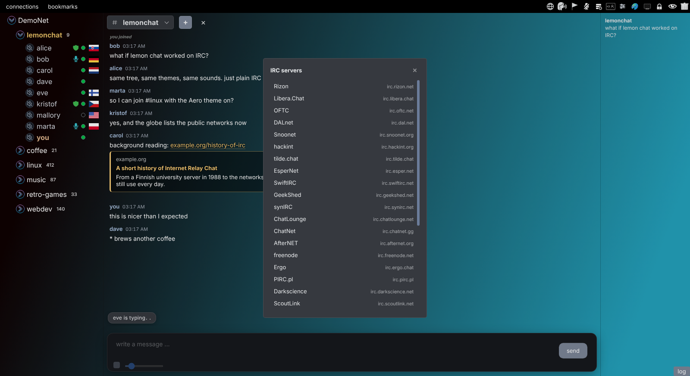
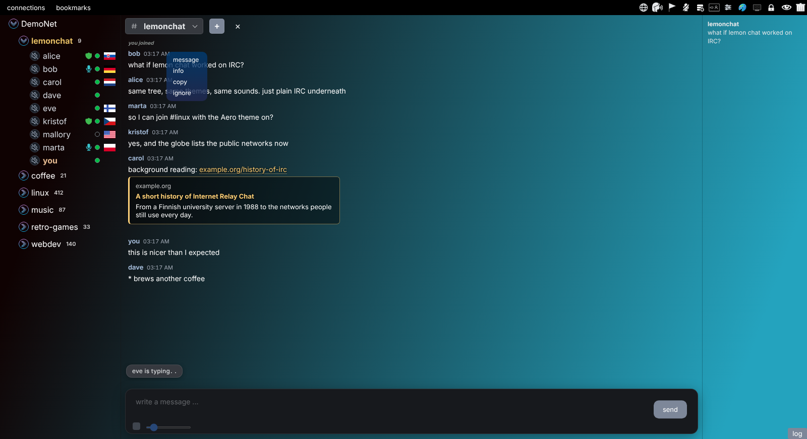
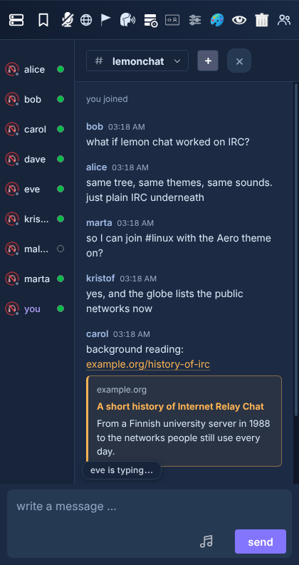

  

<h1 align="center">Lemon IRC</h1>

<b>What if Lemon Chat worked on IRC?</b>

This project answers that question. It takes the Lemon Chat web client, with its channel tree, themes, sounds and layout, and connects it to ordinary IRC networks such as Libera.Chat, OFTC and Rizon. A small Node.js bridge on your computer carries the connection, so the client runs in any modern browser or as a desktop app.

## Features

- The Lemon Chat channel tree, with the public channel list of the network, member counts and roles
- Eight themes from Lemon Chat: Default, Hybrid, Hybrid v2, Aero, Termix, Ozone, Mobile and Mobile 2
- A server list that combines verified networks with public directories such as netsplit.de
- Private chats with anyone online, including people who share no channel with you
- Right-click menus on chat messages, plus an ignore list you can edit later
- Link previews, image previews and typing indicators
- Account login with SASL, saved identities and channel management for operators
- Lemon Chat's sound clips, with a switch for each event
- A desktop app for Windows and Linux in a single file

## Download

Each release has two files:

| System | File | How to start |
| --- | --- | --- |
| Windows 10 and 11 | `lemon-chat-irc-<version>-portable-x64.exe` | Double-click it. Nothing is installed. |
| Linux (x86-64) | `lemon-chat-irc-<version>-linux-x86_64.AppImage` | Run `chmod +x` on the file, then start it. |

The desktop app contains the bridge and the client, and it doesn't need Node.js. Windows can show a SmartScreen warning the first time, because the file isn't code-signed. Choose **More info → Run anyway**.

## Run from source

1. Install [Node.js](https://nodejs.org) 24 or later.
2. Start `start.bat` on Windows, or `sh start.sh` on Linux and macOS.
3. Your browser opens `http://127.0.0.1:19167/`.
4. Click the globe in the toolbar, choose a network, enter a nickname and press **connect**.

Running from source needs no `npm install`. The WebSocket library is included in `vendor/ws`.

## Screenshots

| | |
| --- | --- |
|  |  |
| Aero | Termix |
|  |  |
| Hybrid v2 | Ozone |
|  |  |
| The server list behind the globe button | Right-click a message to start a private chat or ignore someone |

## Documentation

- [Getting started](docs/getting-started.md): connecting, nicknames, accounts and channels that require a login
- [Using the client](docs/using.md): channels, private chats, the message menu, ignoring, previews, settings and themes
- [Server list](docs/server-list.md): where the list of networks comes from and how a server gets picked
- [Desktop app and releases](docs/desktop-app.md): building the `.exe` and the AppImage
- [How it works](docs/architecture.md): the bridge, the client build and the project layout
- [Testing](TESTING.md): unit, browser and live network tests

## Build the desktop app

| System | Command | Result in `dist/` |
| --- | --- | --- |
| Windows | `build-windows.bat` | Portable `.exe` |
| Linux | `bash build-linux.sh` | `.AppImage` |
| macOS | `bash build-mac.sh` | `.dmg` for Intel and Apple silicon |

Each script checks for Node.js 22.12 or later, installs the locked build dependencies with `npm ci` and packages the app. The Windows and Linux packages can also be built on Linux. See [Desktop app and releases](docs/desktop-app.md).

## Project status

The client covers everyday IRC use: channels, private messages, topics, roles, nickname changes, channel browsing, account login and basic operator commands. It doesn't implement automatic reconnect, bouncer sessions, server-side chat history, DCC file transfers or voice. IRC has no voice transport, so Lemon Chat's voice and streaming features are hidden.

## Credits

- The interface, themes and sounds come from the Lemon Chat web client.
- [ws](https://github.com/websockets/ws) (MIT) is included in `vendor/ws`.
- The role icons come from [Tabler Icons](https://tabler.io/icons) (MIT); their license is in `vendor/tabler-icons`.
- Parser test cases come from [ircdocs/parser-tests](https://github.com/ircdocs/parser-tests); their license is in `tests/fixtures/parser-tests`.
- The server list uses data from [netsplit.de](https://netsplit.de), [IRCHelp.org](https://www.irchelp.org), [ircbits.com](https://ircbits.com) and [ircnet.info](https://www.ircnet.info).

No license has been chosen for this project yet.
