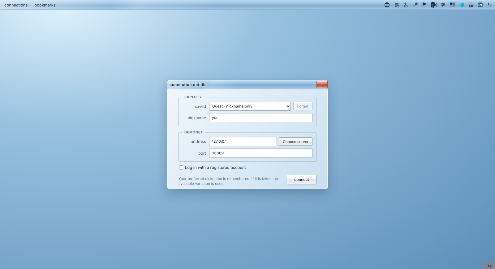

# Getting started

## Start the client

**Desktop app.** Start the `.exe` on Windows or the `.AppImage` on Linux. The window opens with the connection details.

**From source.** Start `start.bat` on Windows or `sh start.sh` on Linux and macOS. If Node.js 22.12 or later isn't installed, the script downloads Node.js 24 into `.tools` first. It then stops an earlier copy of the bridge, builds `client.html`, starts the bridge and opens `http://127.0.0.1:19167/` in your default browser. You can bookmark that address.

## Connect to a network

1. Click **Choose server** in the connection window, or the **globe** in the toolbar. The server list opens, sorted by the number of users.
2. Click a network. Its address and port appear in the connection window.
3. Enter a nickname and press **connect**.

The client remembers your nickname. If someone else is using it, the client tries a similar nickname for this connection, and your saved choice stays the same.

After connecting, the public channels of the network appear in the channel tree. Double-click a channel to join it. On a phone, tap it.

## Log in with an account

Many networks let you register your nickname as an account. To use an account you already have:

1. In the connection window, tick **Log in with a registered account**.
2. Enter the account name and password.
3. Press **connect**.

The client logs in with SASL during the connection, before it joins any channel. It remembers the account name for that server. It never saves the password.

### Registering a nickname

The client can't register accounts for you, because every network does it differently. On Libera.Chat, for example:

1. Connect with the nickname you want to keep.
2. Click **+** next to the conversation selector, enter `NickServ` and press Enter.
3. Send `REGISTER yourpassword you@example.com`.
4. Libera emails you a `VERIFY REGISTER …` line. Send it to NickServ the same way.

See the network's own guide, such as [Libera's registration guide](https://libera.chat/guides/registration).

### "Cannot send message to channel (+R)"

Some channels only accept messages from people logged into an account. Libera's `#linux` is one of them. You see this error when you're connected as a guest. Register your nickname once, then connect with **Log in with a registered account** ticked.

## Where things are saved

| What | Where |
| --- | --- |
| Nickname, account names, theme, settings, ignore list | The browser's local storage, or the desktop app's profile |
| Server list cache | `networks.cache.json` next to the bridge, or `%APPDATA%\Lemon IRC\` in the desktop app |
| Bridge access key | `bridge.token` next to the bridge, when started from source |
| Passwords | Not saved |
| Chat history | Kept in memory until you close the conversation or reload the page |
