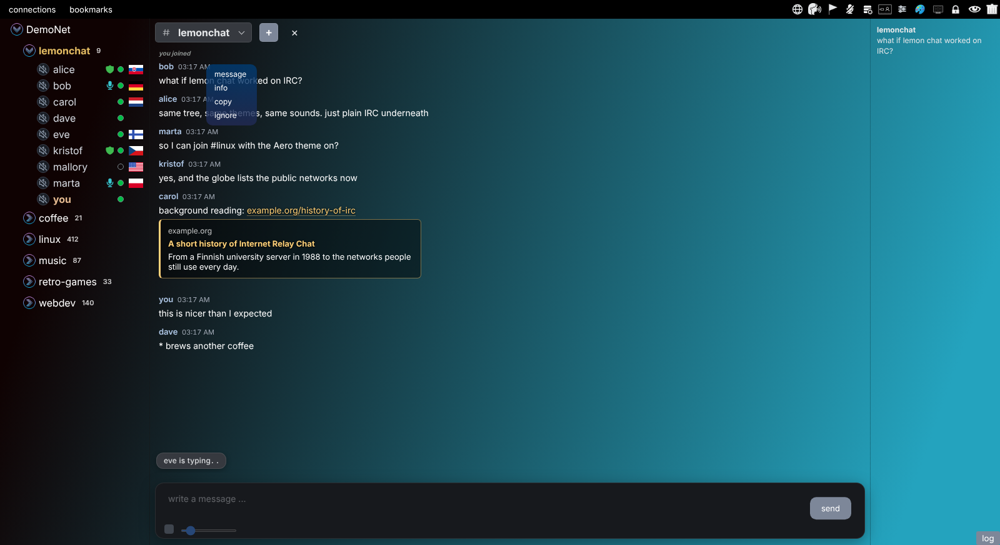

# Using the client

## The channel tree

The tree on the left lists the network's public channels with their user counts. A `#` at the start of a channel name is hidden, so `#music` appears as **music**.

- **Double-click** a channel to join it. A channel with a password asks for it.
- **Click the arrow** next to a channel to see its members without joining.
- **Right-click the network** to refresh the channel list, create a channel, start a private chat, sort the channels or open the command window.
- **Right-click a channel** to join, open, leave, edit its topic, see its information, change its settings or sort its members.
- **Ctrl+F** shows a filter above the tree.

Member rows show three columns on the right: the role icon, the activity dot and the country flag. Each column keeps its place in every row, and stays empty for people without a role or a known country.

| Role icon | Role |
| --- | --- |
| Crown | Channel owner (`~`) |
| Shield with a check mark | Channel admin (`&`) |
| Shield | Channel operator (`@`) |
| Half shield | Half operator (`%`) |
| Microphone | Voice (`+`) |
| Lightning bolt | IRC network operator |

A person with several roles shows the highest one. Hover over the icon to see all of them.

The activity dot is green when the person did something in the last minute and gradually fades to black over two hours. Messages, notices, joins, leaving, nickname and topic changes, mode changes, kicks, away changes and typing count as activity. An empty circle means no activity has been seen during this connection. With the **recently active** member sort, people move to the top when they do something.

## Conversations

The selector above the chat lists your open conversations. Channels appear under **channels** with a `#` icon, and private chats under **people** with a person icon. Each conversation shows its unread count.

### Private chats

On IRC you can message anyone who is online, even if you share no channel with them.

- Click **+** next to the conversation selector, type a nickname and press Enter. If the person is online, the chat opens. Otherwise you see "No user named … is online on …".
- Or type a nickname into the selector's search and choose **Message …**.
- Or choose **message** from the menu of a chat message or a member.

### The message menu

Right-click a chat message, or click the sender's name, to open a small menu:

| Item | What it does |
| --- | --- |
| message | Opens a private chat with the sender |
| info | Shows what the server reports about the sender |
| copy | Copies the message text |
| ignore | Hides the sender's messages |

### Ignoring people

Ignoring someone hides their earlier and new messages, their private messages and their typing notices. The ignore list is saved separately for each network.

To unignore someone, open **Settings → Chat → ignored users** and press **Stop ignoring**. You can also type a nickname there to ignore someone in advance.

## Links and previews

Links appear as short orange text, such as `example.org/history-of-irc`. Hover over a link to see the full address.

| Setting (Settings → Chat) | Default | What it does |
| --- | --- | --- |
| show image and media previews | On | Shows linked images, audio and video below the message |
| show website previews | Off | Shows a card with the page's title, summary and picture. When it's off, linked pages are never requested. |

## Typing and scrolling

When someone's client reports typing, a small "… is typing" label appears above the message box.

**Settings → Chat → always scroll to new messages** is on by default. It jumps to the newest message when one arrives, even if you scrolled up.

## Appearance

- The **palette** button in the toolbar switches themes.
- **Settings → Appearance → chat message width** limits how wide a message can be, from 30 to 100 percent of the chat area.
- **Settings → Appearance → conversation list height** sets the height of the conversation selector's list.
- To make the whole interface larger or smaller, press **Ctrl +**, **Ctrl −** and **Ctrl 0**. This works in the browser and in the desktop app.

## Sound

The toolbar's speaker button mutes all sounds. **Settings → Audio** has a switch for each event, such as messages, joins and failed actions, and a **play test sound** button.

## Uploading files

IRC itself can't send files or images. A few networks advertise an upload service through the `FILEHOST` extension. On those networks the image and file buttons appear next to the message box, and an upload posts a link in the chat. On every other network the buttons are hidden.

## Command window

Right-click the network and choose **commands** to type IRC commands directly:

| Command | What it does |
| --- | --- |
| `/join #channel` | Joins a channel |
| `/part` | Leaves the current channel |
| `/nick newname` | Changes your nickname |
| `/msg nickname text` | Sends a private message |
| `/query nickname` | Opens a private chat |
| `/whois nickname` | Asks the server about a user |
| `/me action` | Sends an action |
| `/list` | Refreshes the channel list |
| `/quote COMMAND` | Sends a raw IRC command |
| `/quit` | Disconnects |

In the command window, a line without a slash is sent to the server as it is. Text typed in the normal message box is always sent as a message, even when it starts with `/`.

## Channel and operator tools

Channel operators can right-click a channel and choose **settings** to change the topic, the channel modes, the password, the user limit and the ban list. The member menu offers notice, invite, kick, ban and role changes. The network decides whether each change is allowed.

The toolbar's server button opens **IRC management**. It shows server information and lets IRC operators log in with `OPER`, disconnect a user with `KILL` or reload the server configuration with `REHASH`. Each action asks for confirmation first.
